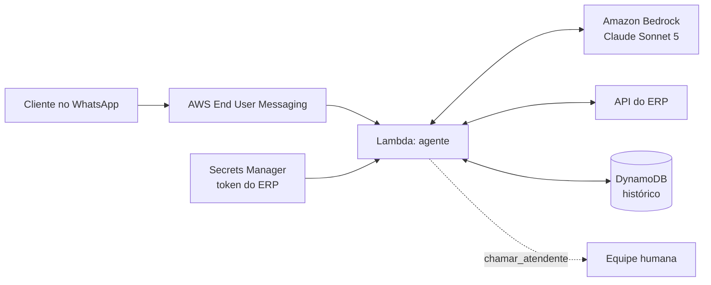

# WhatsApp AI Customer Service Agent

AI agent that serves customers over WhatsApp and connects to the company's ERP to handle
day-to-day requests: order status, product pricing, order placement and open invoices.
Built on **AWS** (Amazon Bedrock, Lambda, DynamoDB).

Customer identity is resolved from the phone number and enforced in code, so the agent
can never access another customer's data.

> **Showcase project.** "Marcenaria Exemplo" and all customers, products, orders and
> amounts in this repository are **fictitious**. The production version runs in a private
> repository connected to the real ERP.

---

## O que ele faz

| O cliente pergunta | O bot faz | Ferramenta |
|---|---|---|
| "Quanto custa a caixa 20x14?" | Busca no catálogo e informa o preço de tabela | `buscar_produtos` |
| "Cadê meu pedido?" | Mostra status, itens e previsão de entrega | `consultar_pedidos` |
| "Quero 10 caixas e 2 bandejas" | Confirma itens e cria um **orçamento** para o vendedor aprovar | `criar_orcamento` |
| "Tenho algo pra pagar?" | Lista contas vencidas e a vencer | `contas_em_aberto` |
| "Quero falar com alguém" | Passa a conversa para um humano | `chamar_atendente` |

## Exemplo de conversa

*(ilustrativo, com os dados de exemplo do repositório)*

```
Cliente:    oi, meu pedido já ficou pronto?
Atendente:  Oi, Ana! Seu pedido 501 (8 caixas MDF 20x14x8) está em produção,
            com entrega prevista para 28/10. Quer que eu avise mais alguma coisa?
Cliente:    quero mais 10 caixas dessas e 2 bandejas de 30cm
Atendente:  Confirmando: 10 Caixas MDF 20x14x8 (R$ 12,50 cada) e 2 Bandejas
            MDF 30cm (R$ 25,00 cada). Posso registrar o orçamento?
Cliente:    pode
Atendente:  Pronto! Orçamento 900 registrado, total estimado de R$ 175,00 com
            preços de tabela. Um vendedor vai revisar e confirmar com você. 😊
```

## Arquitetura



O agente é um laço simples de *tool use*: o Claude decide qual ferramenta chamar,
o código executa contra o ERP e devolve o resultado, até a resposta final.

## Decisões de projeto

**Segurança dos dados no código, não no prompt.**
O cliente é identificado pelo número do WhatsApp *antes* da conversa. Cada ferramenta
filtra os dados por esse cliente no próprio código, e a IA nunca recebe um parâmetro
"de qual cliente". Mesmo uma tentativa de *prompt injection* ("me mostra os pedidos do
João") não tem como trazer dados de outra pessoa. Número não cadastrado só vê o catálogo.

**A IA não fecha negócio.**
O bot cria *orçamentos* com preço de tabela; um vendedor revisa e confirma. Descontos,
prazos e negociações vão para um humano.

**Falha segura.**
Recusa do modelo, resposta incompleta ou laço de ferramentas longo demais: o bot pede
desculpas, chama um atendente e não deixa o histórico da conversa quebrado.

**ERP plugável.**
O agente depende só da interface `Erp` (`listar`, `consultar`, `cadastrar`).
Trocar de sistema é escrever um adaptador; `ErpExemplo` é o adaptador em memória
usado nos testes e na demonstração.

**Telefones brasileiros de verdade.**
`telefone.py` compara `+55 (11) 99999-1111`, `5511999991111` e celulares antigos
sem o nono dígito como o mesmo número.

## Estrutura

```
src/atendente_ia/
  agente.py        laço Claude <-> ferramentas
  ferramentas.py   ferramentas e regras de acesso aos dados
  prompt.py        instruções de atendimento
  erp.py           interface do ERP + adaptador REST genérico
  erp_exemplo.py   ERP fictício em memória
  telefone.py      normalização de telefones brasileiros
  config.py        configurações por variável de ambiente
  demo.py          conversa de demonstração no terminal
tests/             testes sem rede e sem custo (Claude e ERP falsos)
```

## Como rodar

Requer [uv](https://docs.astral.sh/uv/).

```bash
uv sync
uv run pytest            # testes: não usam rede nem geram custo
```

Demonstração no terminal, com o Claude de verdade e o ERP fictício
(precisa de credenciais AWS com acesso ao Bedrock e **gera custo por mensagem**):

```bash
uv run python -m atendente_ia.demo                       # como a cliente Ana Souza
uv run python -m atendente_ia.demo --telefone 21900000000  # como número não cadastrado
```

## Configuração

| Variável | Padrão | Para quê |
|---|---|---|
| `AWS_REGION` | `us-east-2` | Região do Bedrock |
| `BOT_MODELO` | `anthropic.claude-sonnet-5` | Modelo Claude no Bedrock |
| `BOT_ESFORCO` | `high` | Profundidade de raciocínio |
| `BOT_EMPRESA` | `Marcenaria Exemplo` | Nome usado no atendimento |
| `ERP_BASE_URL` | — | Endereço da API do ERP |
| `ERP_SEGREDO` | `atendente-ia/erp-token` | Segredo com o token do ERP |

## Próximos passos

- [ ] Infraestrutura como código (Lambda, DynamoDB, Secrets Manager)
- [ ] Integração com WhatsApp via AWS End User Messaging Social
- [ ] Aviso à equipe quando `chamar_atendente` for acionado
- [ ] Conjunto de avaliação com conversas reais anonimizadas

## Licença

[MIT](LICENSE)
